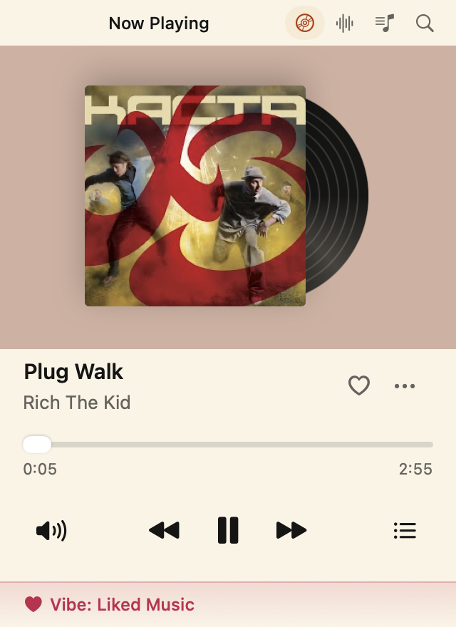
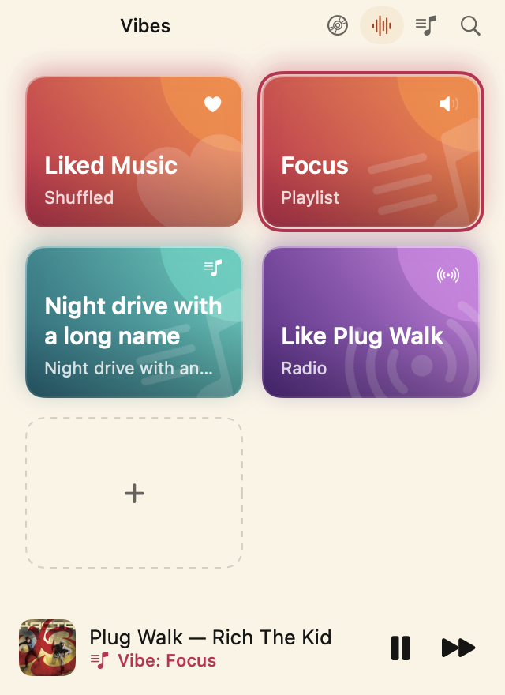
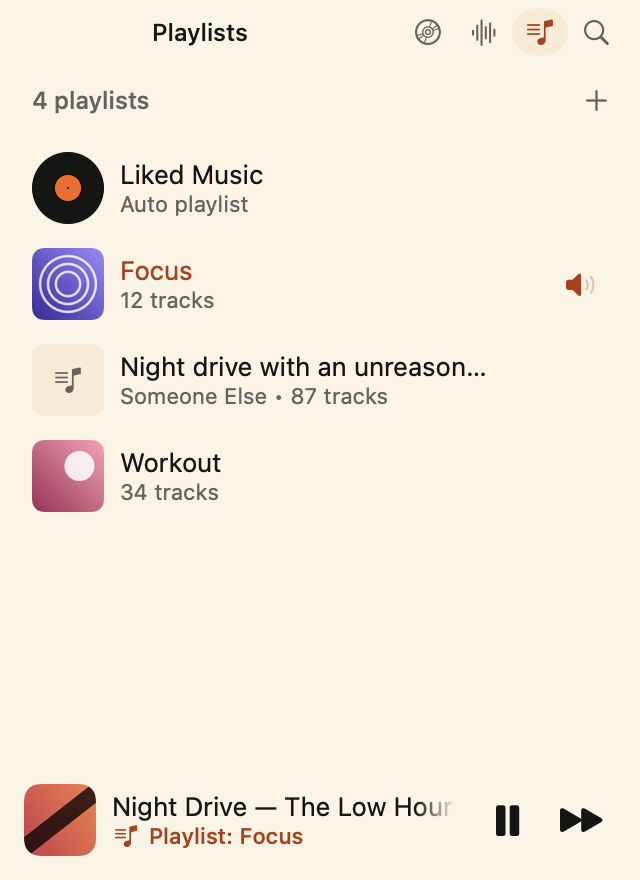
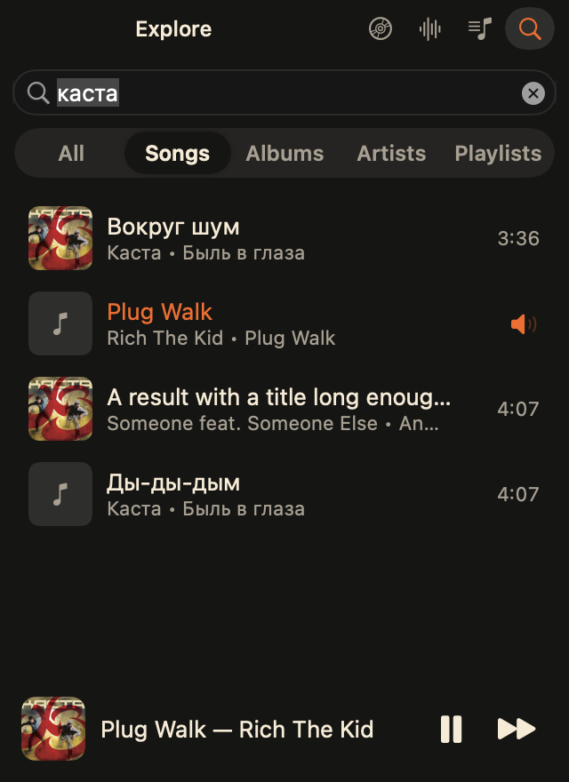

# B-Side

YouTube Music as a small Mac app: a window, a record in the menu bar, and
about a third of the memory the web page takes. Free and open source.

<p>
  
  
  
  
</p>

**[Download B-Side.dmg](https://github.com/anhile/b-side/releases/latest/download/B-Side.dmg)**
· macOS 14 or later · Apple silicon and Intel

## What it does

- **Vibes:** a mood in one click. A tile is a playlist, Liked Music
  shuffled, a track's radio, or a few words of your own ("rainy Sunday,
  slow jazz, no vocals").
- **Now Playing:** the record turns while it plays; lyrics follow the song,
  and a click on a line jumps there. Up Next shows what comes.
- **Playlists:** your whole library, private playlists too. Make, rename,
  reorder.
- **Explore:** search songs, albums, artists and playlists.
- **Out of the way:** the menu bar, a desktop widget, media keys and AirPods.
  Close the window and the music plays on.
- **Raycast:** play, pause, skip, like and pick a vibe from the
  [extension](raycast/).

B-Side plays through Google's own player in a hidden web view, without the
YouTube Music page around it: about 175 MB of memory instead of 500.

## Install

Open `B-Side.dmg` and drag B-Side to Applications. The build is not signed
with an Apple certificate yet, so macOS asks once:

1. Open B-Side and click **Done** in the message macOS shows.
2. In System Settings → Privacy & Security, click **Open Anyway** next to
   B-Side.

Or build it yourself; macOS does not ask about an app built on your own
Mac. You need Xcode and [XcodeGen](https://github.com/yonaskolb/XcodeGen):

```bash
./scripts/install.sh
```

Run B-Side from `/Applications`: Open at login and menu bar managers need
it there. Sign in to Google in B-Side's window, or continue as a guest:
search and radio work without an account.

## Good to know

- **Ads:** B-Side does not remove them. Without YouTube Premium you hear
  them, and B-Side says when the music comes back.
- **Privacy:** B-Side talks to Google with your own session, and to no one
  else unless you ask: LRCLIB for lyrics YouTube Music has no timing for,
  and the vibe server if you turn it on. No analytics.
  [PRIVACY.md](PRIVACY.md) has the details.
- **Vibes from words** are read by Apple's on-device model (macOS 26, Apple
  Intelligence on). A switch in Settings, off by default, sends the words to
  the [B-Side server](server/) instead: a larger model, 10 vibes a month.
- **It can break.** B-Side depends on how YouTube Music's web player works
  inside, which changes without notice. It is not affiliated with Google or
  YouTube.

## Shortcuts

| | |
|---|---|
| Space | Play or pause |
| Command-Right, Command-Left | Next, previous |
| Command-L | Like |
| Command-R | Repeat |
| Shift-Command-V | Play Vibe |
| Command-Up, Command-Down | Volume |
| Command-1 to Command-4 | The pages |

Right-click a track anywhere for its menu. `bside://toggle`, `next`,
`previous`, `like`, `show` and `vibe` work from anything that opens URLs.

## More

- [Troubleshooting](docs/TROUBLESHOOTING.md)
- [Architecture](docs/ARCHITECTURE.md) and [development](docs/DEVELOPMENT.md)
- [Releasing](docs/RELEASING.md), [contributing](CONTRIBUTING.md),
  [security](SECURITY.md)
- [Design](DESIGN.md), [screens](design/SCREENS.md),
  [research](docs/research/)

MIT licence, see [LICENSE](LICENSE).
